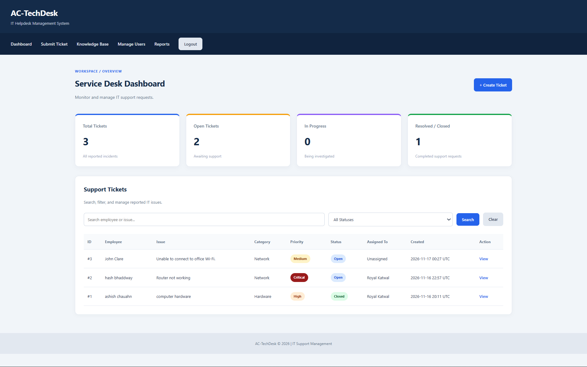
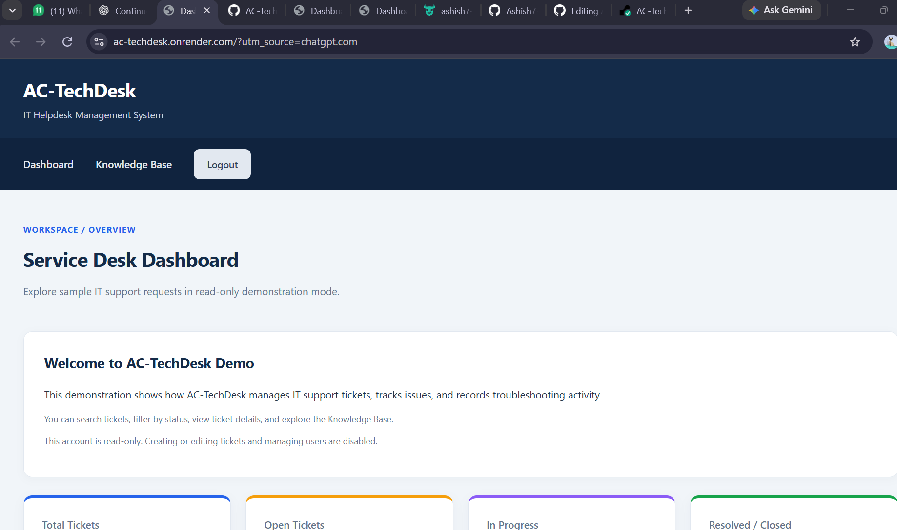
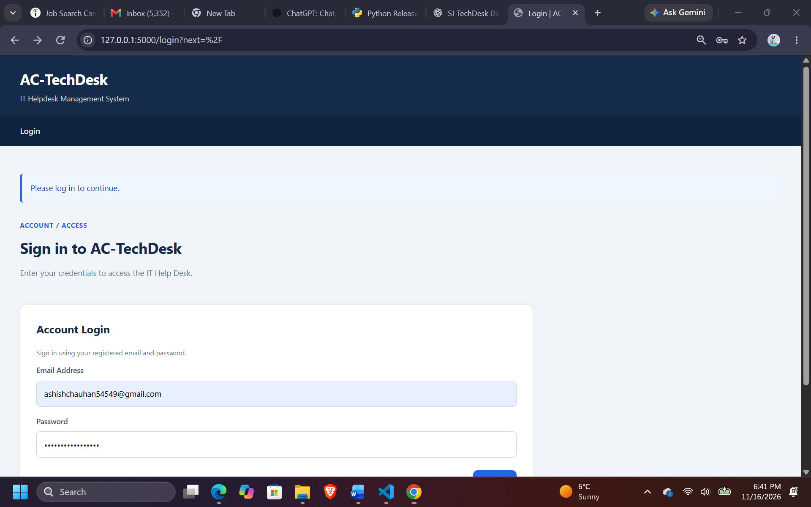
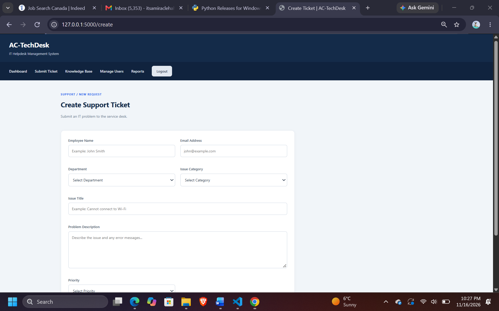
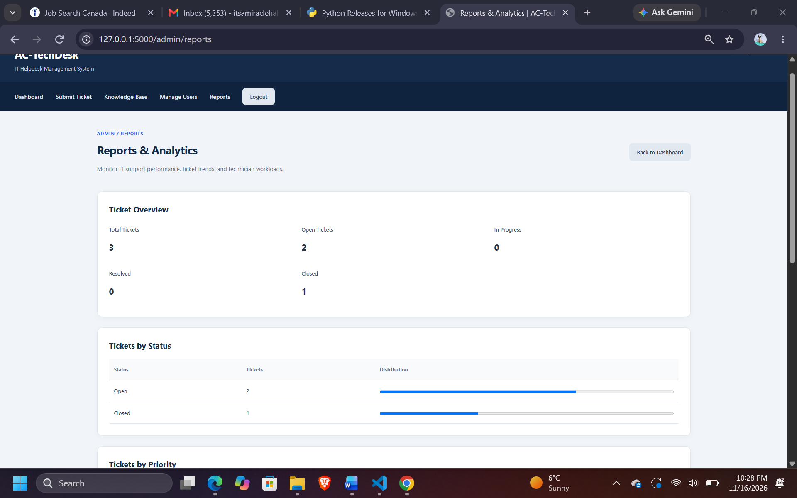
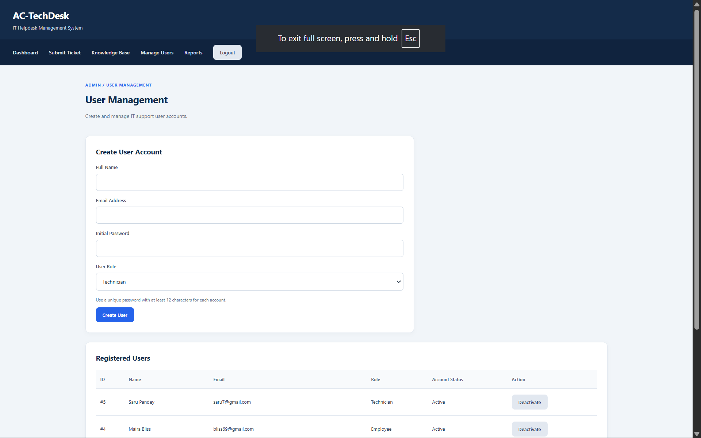

# AC-TechDesk - IT Help Desk Management System

AC-TechDesk is a web-based IT Help Desk Management System built with Python, Flask, HTML, CSS, and SQLite.

The project simulates a company IT support environment where employees can report technical problems, technicians can troubleshoot issues, and administrators can manage support requests and user accounts.

I developed this project to gain practical experience with IT support workflows, ticket management, user authentication, databases, and role-based access control.

## Live Application

**Live Website:** https://ac-techdesk.onrender.com

**GitHub Repository:** https://github.com/Ashish7-c/AC-TechDesk

**Hosting:** Render

**Cloud Database:** Turso (libSQL)

The live application includes a read-only Demo Viewer account with six fictional IT support tickets.

## Project Features

### IT Support Ticket Management

- Create and submit IT support tickets
- Record employee and department information
- Categorize hardware, software, network, and other IT issues
- Set ticket priority levels
- Track ticket status
- Assign tickets to registered technicians
- Add troubleshooting and resolution notes
- View ticket activity history
- Search and filter support tickets

### User Authentication

- Secure user login and logout
- Password hashing
- Role-based access control
- Account activation and deactivation
- Protected application routes
- CSRF protection

### Administrator Features

Administrators can:

- View all support tickets
- Create and manage user accounts
- Activate or deactivate accounts
- Assign tickets to technicians
- Update ticket status and resolution notes
- Access reports and analytics

### Technician Features

Technicians can:

- View tickets assigned to them
- Investigate technical problems
- Update ticket status
- Record troubleshooting steps
- Add resolution notes
- Review ticket activity

### Employee Features

Employees can:

- Submit IT support requests
- View their own submitted tickets
- Track ticket progress
- Review resolution notes

### Demo Viewer Features

AC-TechDesk includes a read-only Demo Viewer account for recruiters and portfolio visitors.

Demo Viewers can:

- Explore six fictional support tickets
- View dashboard statistics
- Search and filter tickets
- Open their own sample ticket details
- Read troubleshooting and resolution notes
- Access the Knowledge Base

Demo Viewers cannot:

- Create new tickets
- Edit ticket details
- Change ticket status
- Assign technicians
- Manage users
- Access administrative reports
- View tickets belonging to other users

These restrictions are enforced by the Flask backend, not just by hiding buttons.

## Dashboard and Analytics

The dashboard displays:

- Total tickets
- Open tickets
- Tickets in progress
- Resolved and closed tickets

The administrator reports page also provides:

- Ticket counts by status
- Ticket counts by priority
- Ticket counts by category
- Technician workload information

## Knowledge Base

The Knowledge Base provides basic troubleshooting information for common IT problems, including:

- Wi-Fi and network connectivity
- Email troubleshooting
- Printer issues
- Windows login problems
- General computer troubleshooting

## Technologies Used

| Technology | Purpose |
|---|---|
| Python | Backend programming |
| Flask | Web application framework |
| HTML5 | Web page structure |
| CSS3 | User interface styling |
| Jinja2 | Dynamic HTML templates |
| SQLite | Local development database |
| Turso (libSQL) | Persistent cloud database |
| Flask-Login | Authentication and user sessions |
| Flask-WTF | CSRF protection |
| Werkzeug | Password hashing |
| Gunicorn | Production application server |
| Render | Web application hosting |
| Git and GitHub | Version control and source code management |

## Application Architecture

AC-TechDesk follows a Flask-based web application architecture.

1. A user opens the application in a browser.
2. Flask handles the request and checks authentication.
3. Role-based permissions determine what the user can access.
4. The application reads or updates information in the database.
5. Flask renders the page using Jinja2 templates.

The project uses two database environments:

**Local Development**

SQLite stores data in the local `ac_techdesk.db` file.

**Live Deployment**

Turso stores the application's data in the cloud. The Flask application connects to Turso through a custom HTTP database adapter.

This allows the hosted application to keep its data across restarts and deployments.

## User Roles and Permissions

| Feature | Admin | Technician | Employee | Demo Viewer |
|---|---|---|---|---|
| View all tickets | Yes | No | No | No |
| View assigned tickets | Yes | Yes | No | No |
| View own submitted tickets | Yes | No | Yes | No |
| View own sample tickets | Yes | No | No | Yes |
| Create tickets | Yes | Yes | Yes | No |
| Update ticket status | Yes | Yes | No | No |
| Add resolution notes | Yes | Yes | No | No |
| Assign technicians | Yes | No | No | No |
| Manage users | Yes | No | No | No |
| View admin reports | Yes | No | No | No |
| Access Knowledge Base | Yes | Yes | Yes | Yes |

## Installation

### 1. Clone the Repository

```bash
git clone https://github.com/Ashish7-c/AC-TechDesk.git
cd AC-TechDesk
```

### 2. Create a Virtual Environment

```bash
python -m venv venv
```

### 3. Activate the Virtual Environment

For Windows PowerShell:

```powershell
.\venv\Scripts\Activate.ps1
```

### 4. Install Dependencies

```bash
python -m pip install -r requirements.txt
```

### 5. Initialize the Local Database

Run the Flask application:

```bash
python app.py
```

This initializes the local SQLite database if the required tables do not already exist.

Stop the server using `Ctrl + C`.

### 6. Create an Administrator Account

```bash
python create_admin.py
```

Follow the prompts to create an administrator account.

### 7. Start the Application

```bash
python app.py
```

Open the local address displayed in the terminal, commonly:

http://127.0.0.1:5000

The hosted application is available at:

https://ac-techdesk.onrender.com

## Deployment

AC-TechDesk is deployed on Render using Flask and Gunicorn.

The production application uses Turso instead of the local SQLite database.

The following environment variables are configured for deployment:

- `SECRET_KEY`
- `TURSO_DATABASE_URL`
- `TURSO_AUTH_TOKEN`

Database credentials and other secrets should never be committed to GitHub.

## Security Features

AC-TechDesk includes:

- Hashed user passwords
- Authentication using Flask-Login
- Role-based authorization
- CSRF protection
- Server-side access checks
- Restrictions on unauthorized ticket updates
- Account activation and deactivation
- Separation of local and cloud database configurations

Demo Viewer accounts are restricted to read-only operations.

Unauthorized access to administrative pages is blocked with HTTP 403 responses. Access to another user's ticket is blocked with an HTTP 404 response.

The application is a portfolio demonstration and is not intended to store real organizational or sensitive employee information without additional security review.

## Testing

The following features were manually tested:

- User login and logout
- Dashboard visibility
- Ticket creation restrictions
- Admin page restrictions
- Ticket details and read-only permissions
- Knowledge Base access
- Demo Viewer access to sample tickets
- Prevention of access to another user's ticket
- Turso database connectivity
- Live deployment on Render

The live demo contains six fictional support tickets for testing and demonstration.


## Screenshots

### Service Desk Dashboard



### Demo Viewer Dashboard



### Login Page



### Ticket Details



### Admin Reports




### User Management

The administrator can manage employee and technician accounts, assign user roles, and activate or deactivate accounts.




Screenshots can be added to the `screenshots` folder to document these features.

## Project Status

- Core ticket management features completed
- User authentication implemented
- Role-based access control implemented
- Administrator management features completed
- Technician support workflow implemented
- Knowledge Base available
- Demo Viewer account created
- Persistent Turso cloud database connected
- Live application deployed on Render
- Demo Viewer security checks completed

## Future Improvements

Potential future improvements include:

- Password reset functionality
- Email notifications
- Ticket comments
- Service Level Agreement (SLA) tracking
- CSV report exports
- Additional automated tests
- Application monitoring and logging
- Further production security improvements

## Author

Developed by Ashish Chauhan as a Python web development and IT Help Desk portfolio project.

The project demonstrates practical skills in IT support workflows, troubleshooting documentation, authentication, database management, and web application development.

## License

No license has been selected for this project.
